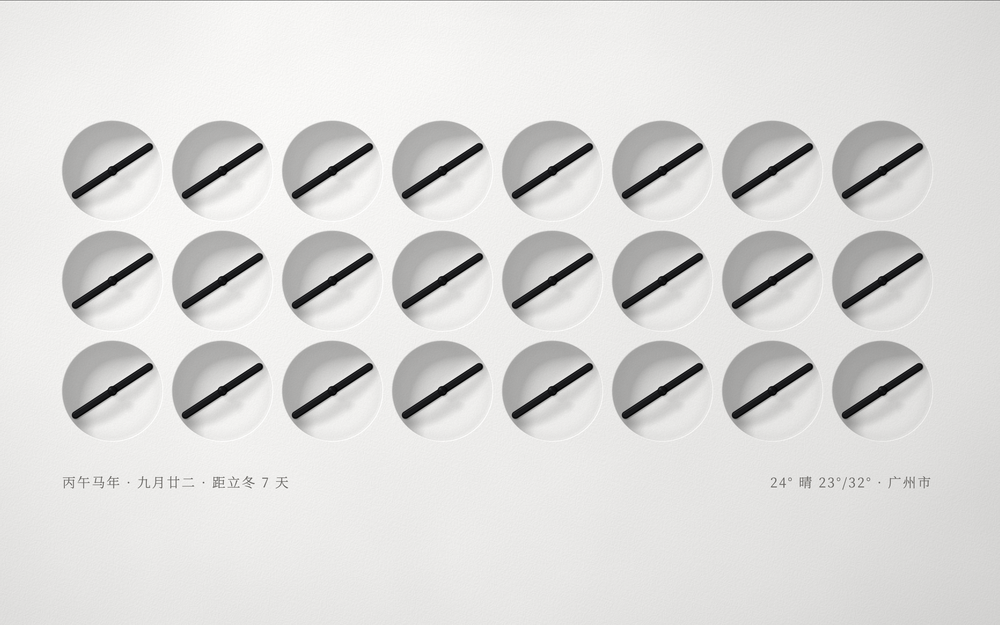

# Kinetic Clock · 动态屏保时钟

一个可以在浏览器里打开的动态时钟，适合全屏放在桌面上，或让闲置的平板变成一块时钟摆件。

画面由 24 个小表盘组成。它们的指针会一起转动，拼出当前时间；每次换分钟，还会先来一段不同的转场动画。



## 能做什么

- 用指针拼出时间，也能切换显示日期和温度。
- 底部显示农历、生肖年份、节气提醒，以及所在城市的天气。
- 支持浅色和深色主题，也能跟随当地日出日落自动切换。
- 可以开启滴答声、秒进度线，并设置日期和温度的自动展示间隔。
- 画面会随屏幕大小调整，电脑、平板和手机都可以打开。

## 怎么用

打开页面后，轻点画面进入；浏览器支持时会进入全屏。再次轻点，可以在时间、日期和温度之间切换，温度需要先获取天气。

轻点画面会显示工具按钮，可以切换全屏、日夜主题，或打开设置。城市留空时会尝试自动定位，也可以手动填写城市名称。天气需要联网，定位和手机倾斜感应需要浏览器支持并授权。

## 在自己的电脑上运行

先安装 Node.js，然后在项目目录中运行：

```bash
npm install
npm run dev
```

在浏览器中打开终端显示的地址即可。

如果要生成用于部署的网页文件，运行：

```bash
npm run build
```

生成的文件在 `dist/` 目录中。

## 开源协议

[MIT License](LICENSE)
